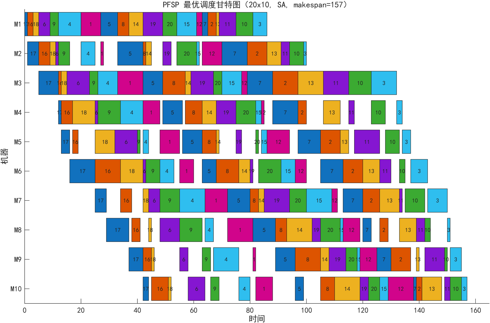
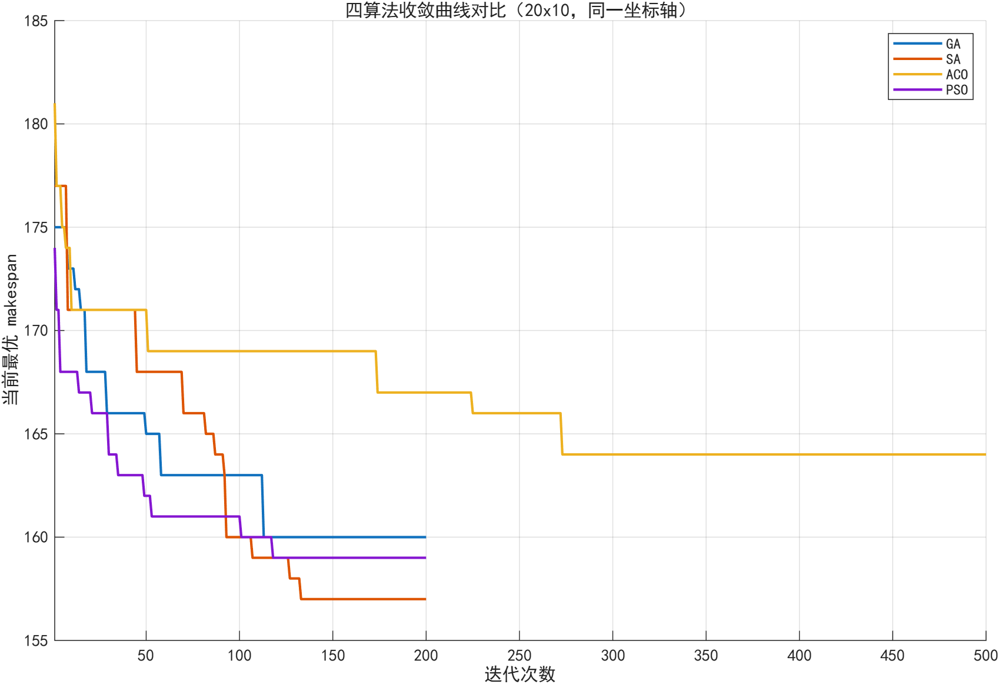
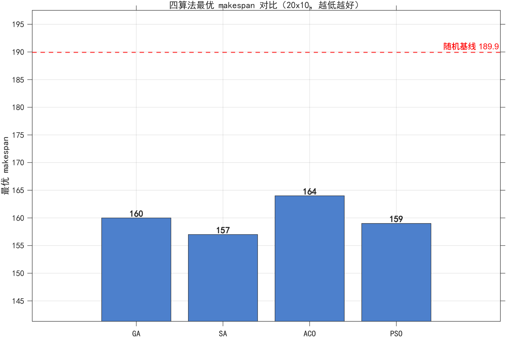

# 置换流水车间调度：四种智能算法对比

课程设计作业，2026 年秋。用 GA / SA / ACO / PSO 四种自实现的算法求解 PFSP，比较解的质量和稳定性。

## 问题

置换流水车间调度（Permutation Flow Shop Scheduling）：n 个工件在 m 台机器上按同一顺序加工，目标是找一个工件排列 π，让最大完工时间（makespan）最小。

给定加工时间矩阵 P，评价一个排列就是按完工时间递推一遍，O(nm)，很快。难的是排列组合——20 个工件的排列有 20! ≈ 2.4×10¹⁸ 种，只能靠启发式。

## 算例

两个固定算例存在 `代码/算例/` 下，不随机生成，加工时间取 [1,9] 的均匀整数：

| 算例 | 文件 | 说明 |
|---|---|---|
| 10×4 | `PFSP_10x4_seed42.mat` | 小规模，用来验证实现正确 |
| 20×10 | `PFSP_20x10_seed303.mat` | 大规模，四种算法的差距在这里才显现 |

## 算法

四种算法都是按排列编码手写的，没有调用 `ga` / `simulannealbnd` / `particleswarm`。

| 文件 | 算法 | 关键设置 |
|---|---|---|
| `ga_pfsp.m` | 遗传算法 | 排列编码，锦标赛选择 k=3，OX 交叉 pc=0.85，swap 变异 pm=0.15，精英保留 |
| `sa_pfsp.m` | 模拟退火 | swap 邻域，Metropolis 准则，几何降温 α=0.95，每温度 50 次迭代 |
| `aco_pfsp.m` | 蚁群算法 | 位置模型信息素，轮盘赌逐个位置构造排列，全部蚂蚁沉积 |
| `pso_pfsp.m` | 粒子群 | 随机键编码，靠排序把连续位置映射成排列，惯性权重 0.9→0.4 线性递减 |

四种算法的评估次数统一卡在 10000 次，否则比出来的结果没有意义。

## 结果

每个算例、每种算法各独立跑 50 次，随机种子 `rng(1000+r)`，r = 1…50。

**10×4**

| 算法 | best | mean | std |
|---|---|---|---|
| GA | 70 | 71.28 | 0.67 |
| SA | **69** | **69.00** | 0.00 |
| ACO | **69** | 71.72 | 0.76 |
| PSO | **69** | 70.40 | 1.07 |
| 随机排列 | — | 83.63 | — |

**20×10**

| 算法 | best | mean | std |
|---|---|---|---|
| GA | 160 | 166.76 | 2.94 |
| SA | **157** | **157.98** | 1.17 |
| ACO | 164 | 167.20 | 1.34 |
| PSO | 159 | 161.14 | 1.70 |
| 随机排列 | — | 189.93 | — |

随机排列那一行是 2000 个随机排列的 makespan 均值，用来当"什么都不做"的基线。







## 几点观察

规模小的时候四种算法都摸得到 69，差别只在 std 上；20×10 才真正拉开，SA 领先，ACO 掉队。

SA 在两个算例上都最好，std 也最小（0.00 / 1.17）。降温慢、每温度迭代次数够，搜索得比较细。

ACO 每次迭代成本最高（500 代 × 20 只蚂蚁），但终值反而最差，后期基本停滞——信息素过度集中，蚂蚁走的路径趋同了。

耗时只能当量级参考。同一份代码、同一批种子，两次运行的最优值完全一致，但平均耗时能差到 3 倍（后台进程、磁盘、杀毒扫描都会干扰）。所以结论里不拿时间来排名次。

20×10 的解空间没法穷举，157 只是这 50 次里跑到的最好值，不能说成理论最优。

## 运行

```matlab
cd 代码
main
```

需要 R2018a 或更高版本，只用基础函数，不依赖工具箱。跑完会在当前目录生成 `results_*.mat` 和几个图窗。

小规模算例跑得快，20×10 因为要跑 50×4 遍加上 2000 次随机基线，会久一些。

## 目录

```
MATLAB-PFSP调度/
├── 代码/
│   ├── main.m            主程序
│   ├── makespan.m        目标函数
│   ├── makespan_ref.m    目标函数的独立实现，用于交叉校验
│   ├── ga_pfsp.m
│   ├── sa_pfsp.m
│   ├── aco_pfsp.m
│   ├── pso_pfsp.m
│   ├── 运行说明.txt
│   └── 算例/
└── 图/
```

`makespan_ref.m` 是另写的一份实现，循环顺序和 `makespan.m` 不同。`main.m` 会把两边算出的结果并排打出来对比（`equal=1` 表示一致），用来确认评价函数本身没写错，而不是只靠肉眼看答案合不合理。
